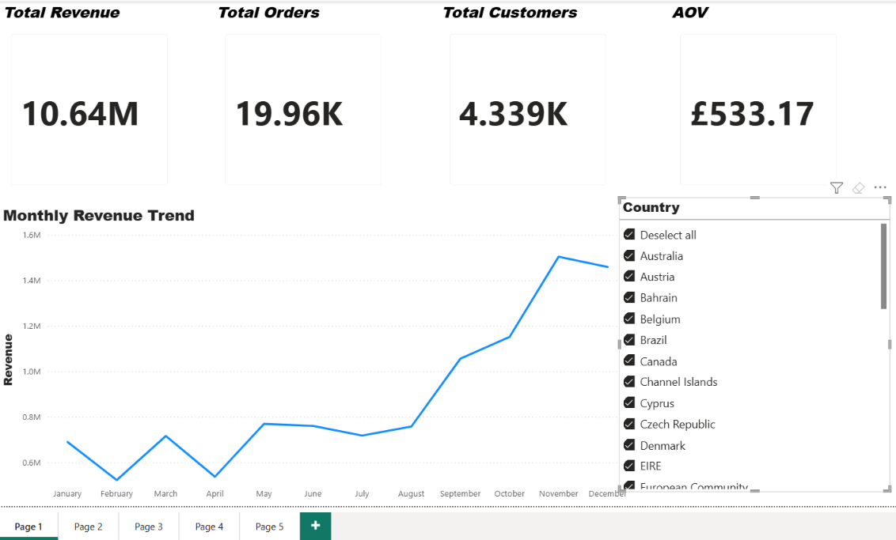
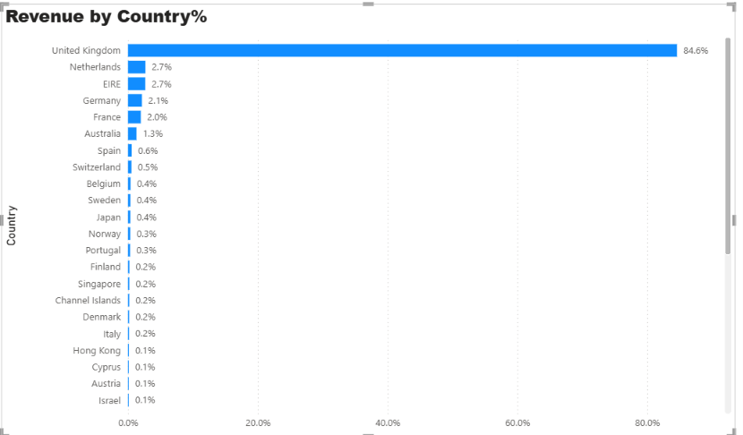
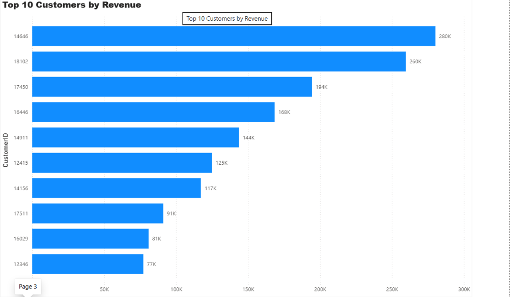
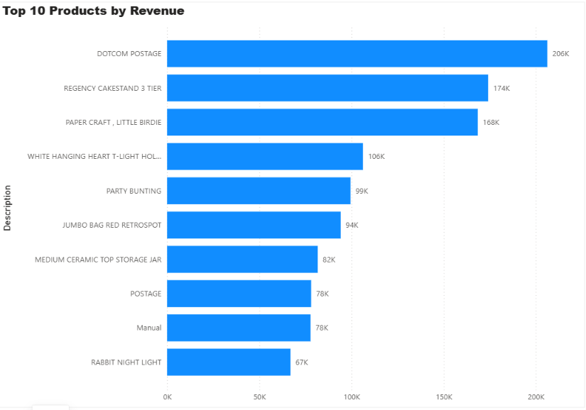
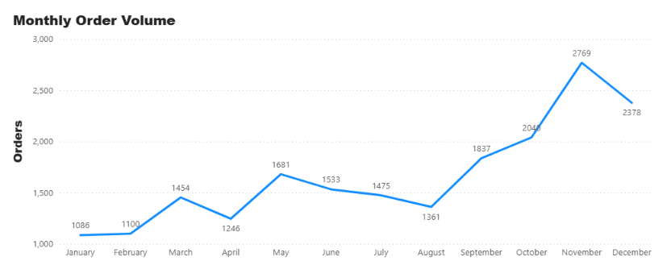

# Online Retail Sales Analysis

**SQL | Power BI | Data Analytics**

## 1. Project Overview

This project explores an online retail dataset to analyse sales performance, revenue trends, product performance, customer purchasing behaviour, and geographic sales distribution.

Using SQL for data analysis and Power BI for data visualisation, the project transforms raw retail data into meaningful business insights through an interactive, multi-page dashboard.

The analysis focuses on understanding business performance, identifying key revenue contributors, and examining patterns in customer orders over time.

## 2. Business Problem

Retail businesses generate large volumes of transactional data, but raw sales records do not always provide an immediate understanding of business performance.

Without structured analysis, it can be difficult to identify which products generate the most revenue, which markets contribute most to sales, which customers have the highest purchasing value, and how order activity changes over time.

This project addresses these challenges by using SQL to analyse retail transactions and Power BI to present the findings in an interactive dashboard.

## 3. Project Objectives

The main objectives were to:

- Analyse overall sales performance and revenue.
- Examine monthly revenue and order trends.
- Identify the countries contributing most to total revenue.
- Evaluate customer purchasing behaviour and identify high-value customers.
- Identify the top-performing products by revenue.
- Explore the dataset to uncover meaningful business patterns.
- Present the findings through an interactive Power BI dashboard.

## 4. Dataset

The project uses the **UCI Online Retail dataset**, which contains transactional records from a UK-based online retail business.

The dataset includes information relating to:
- Invoice numbers
- Product stock codes
- Product descriptions
- Quantities purchased
- Invoice dates
- Unit prices
- Customer IDs
- Country of purchase

The dataset provides a foundation for analysing sales transactions, customer activity, product performance, and international revenue distribution.

## 5. Tools and Technologies

| Tool | Purpose |
|---|---|
| SQL | Data exploration, querying and analysis |
| Power BI | Interactive dashboard development |
| Power Query | Data preparation and transformation |
| DAX | Measures and business calculations |

## 6. Analytical Approach

The project followed a structured analytical workflow.

### Data Exploration and Preparation
The dataset was examined to understand its structure, identify data quality issues, and assess the fields available for analysis.

### SQL Analysis
SQL was used to explore transactional data and investigate key business questions relating to revenue, products, customers, geographic performance, and order activity.

### Business Metrics
Key performance indicators were developed to evaluate overall business performance, including:

- Total Revenue
- Total Orders
- Total Customers
- Average Order Value (AOV)

### Data Visualisation
Power BI was used to transform the analytical findings into a multi-page dashboard, allowing business performance to be explored through different perspectives.

## 7. Key Findings

### Overall Sales Performance

The dashboard reports approximately:

| Metric | Result |
|---|---:|
| Total Revenue | £10.64M |
| Total Orders | 19.96K |
| Total Customers | 4.339K |
| Average Order Value | £533.17 |

These metrics provide an overview of the business's sales performance and customer activity.

### Geographic Revenue Distribution

The United Kingdom dominates the revenue distribution, contributing approximately **84.6% of total revenue**.

Other contributing markets include:
- Netherlands: 2.7%
- EIRE: 2.7%
- Germany: 2.1%
- France: 2.0%
- Australia: 1.3%

This indicates a significant concentration of revenue in the UK market, with the remaining sales distributed across international markets.

### Monthly Revenue Trends

Revenue increased substantially towards the final quarter of the year.

November recorded the highest monthly revenue, at approximately £1.5 million. December remained strong, although revenue declined compared with November.

### Customer Performance

Customer-level analysis identified the ten highest-revenue customers.

The leading customers generated approximately £280K and £260K in revenue respectively, highlighting the contribution of high-value customers to overall sales.

### Product Performance

The top-performing products were identified based on revenue contribution.

The leading products included:

- Doctor Postage: approximately £206K
- Regency Cake Stand 3 Tier: approximately £174K
- Paper Craft, Little Birdie: approximately £168K

This analysis provides visibility into the products contributing most significantly to revenue.

### Monthly Order Volume

Order activity varied throughout the year, with a notable increase towards the final quarter.

November recorded the highest order volume at approximately 2,769 orders, followed by December at approximately 2,378 orders.

## 8. Power BI Dashboard

The final dashboard consists of five analytical pages:

**Page 1 – Sales Overview**

Presents the main business KPIs, including total revenue, total orders, total customers, average order value, and monthly revenue trends.

 

**Page 2 – Geographic Analysis**

 

Examines revenue distribution across countries and highlights the contribution of individual markets to overall sales.

**Page 3 – Customer Analysis**

Identifies the top ten customers by revenue, providing insight into customer value and purchasing contribution.

**Page 4 – Product Analysis**

Highlights the top ten products by revenue, helping identify the products contributing most to sales.

**Page 5 – Order Trends**

Explores monthly order volume to identify changes in purchasing activity throughout the year.

## 9. Business Implications

The findings provide several useful business considerations:

- **Market concentration:** The strong contribution from the UK highlights the importance of the domestic market while presenting an opportunity to evaluate international growth.
- **Customer value:** Identifying high-revenue customers can support customer retention and targeted engagement strategies.
- **Product performance:** Understanding which products generate the most revenue can inform product planning and inventory decisions.
- **Sales trends:** Monitoring monthly revenue and order activity can help businesses evaluate seasonal patterns and plan for changes in demand.

## 10. Conclusion

This project demonstrates how SQL and Power BI can be used together to transform transactional retail data into actionable business insights.

Through data exploration, SQL analysis, business metric development, and dashboard visualisation, the project provides an overview of sales performance, customer behaviour, product contribution, geographic revenue distribution, and monthly order activity.

The resulting dashboard offers a structured view of business performance and demonstrates practical data analytics skills, from working with raw transactional data to communicating findings through visual reporting.

## 11. Skills Demonstrated

- SQL querying and data analysis
- Data exploration and preparation
- Business performance analysis
- Revenue and sales analysis
- Customer segmentation and performance analysis
- Product performance analysis
- Data visualisation
- Power BI dashboard development
- Analytical thinking and business insight communication
